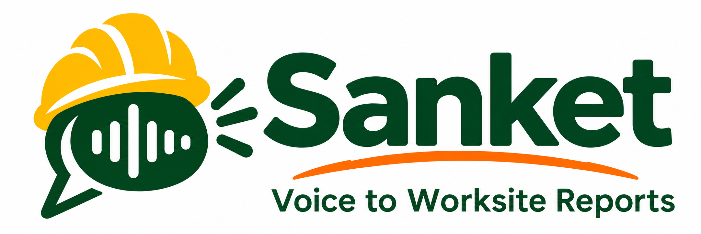
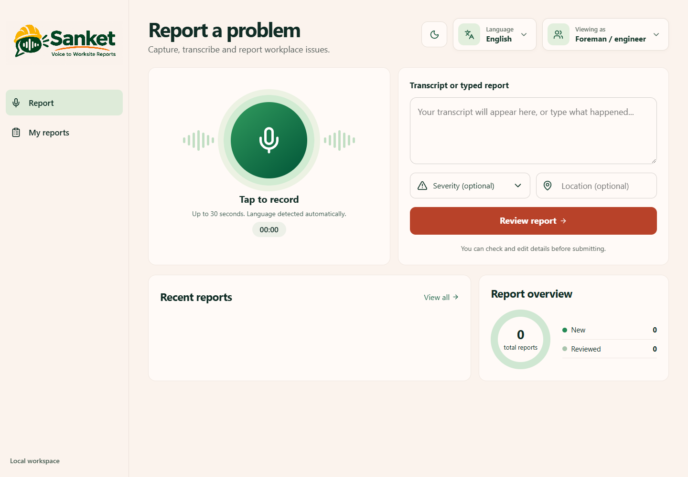
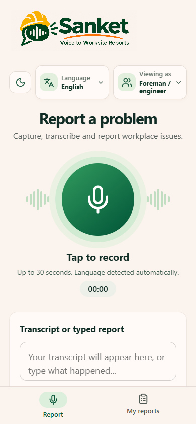



# Speak an issue in any language. Your team reads or hears it in their language.

**Voice to report. Across languages.**

---

##

1. **Speak or type in any language** of what happened.
2. **Review and submit** the prepared report.
3. **Read or listen** to the report in any language.

> A worker can report a problem in Punjabi. A manager can read and hear it in English.

## See it in action

## Try it

1. Record a voice note and select **Transcribe recording**.
2. Check the transcript and select **Review report**.
3. Edit the draft if needed, then **Submit report**.
4. Open **My reports** to read, translate or listen.
5. Switch **Viewing as** to see the project manager view.

**Check the details:** AI-generated transcripts, translations and suggestions can contain mistakes.

---

<strong>Sanket</strong> · Voice to worksite reports

